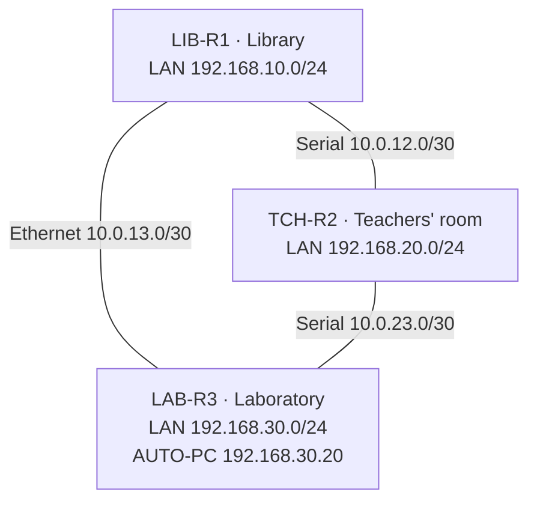

# CCEN 356 Project 1: RIP Dynamic Routing with Python Automation

A three-room school network (Library, Teachers' room, Laboratory) on Cisco 2901 routers running RIPv2, with Python scripts that log into the routers over SSH, push configuration, snapshot the routing tables, and measure how long RIP takes to converge after a link fails.

## Network

Three routers in a triangle, so every room has two paths to every other room. One link is Ethernet, two are 64 kbps serial.



| Router | LAN (G0/0) | Links |
|---|---|---|
| LIB-R1 | 192.168.10.1/24 | S0/0/0 to TCH-R2 (DCE), G0/1 to LAB-R3 |
| TCH-R2 | 192.168.20.1/24 | S0/0/0 to LIB-R1, S0/0/1 to LAB-R3 (DCE) |
| LAB-R3 | 192.168.30.1/24 | G0/1 to LIB-R1, S0/0/0 to TCH-R2 |

Each router runs `router rip`, `version 2`, `no auto-summary`, with its LAN passive. Each room has a 2960 switch with PCs, laptops and a printer. Full configs are in [`configs/source/`](configs/source/); the full design (IP plan, cabling, build steps, expected routing tables) is in [`docs/Part1-Network-Design-and-RIP-Configuration.pdf`](docs/Part1-Network-Design-and-RIP-Configuration.pdf).

## Repository layout

```
configs/source/     paste-in configs for the 3 routers and 3 switches
configs/exports/    show running-config exports from the built devices
configs/push/       config snippets for push_config.py (RIP block, timestamps, T5)
topology/           Packet Tracer file and topology diagram
scripts/            Python automation (below)
tests/              tests for the parsers; no routers needed
data/snapshots/     JSON routing-table snapshots
data/routes.csv     every snapshot, one row per route
data/debug_logs/    debug captures and their parsed CSVs
data/monitor_logs/  convergence monitor logs
data/charts/        charts for the report
docs/               design doc (Part 1: network design and RIP configuration), final report
```

## Scripts

| Script | What it does |
|---|---|
| [`inventory.py`](scripts/inventory.py) | Router list and `connect(name)`, imported by every other script |
| [`connect_test.py`](scripts/connect_test.py) | Logs into each router and checks its hostname: proves SSH works |
| [`push_config.py`](scripts/push_config.py) | Applies config lines from a file to one or more routers, then saves |
| [`get_routes.py`](scripts/get_routes.py) | Snapshots `show ip route rip` on every router to JSON and CSV |
| [`compare_routes.py`](scripts/compare_routes.py) | Lists routes added, removed or changed between two snapshots |
| [`parse_rip_debug.py`](scripts/parse_rip_debug.py) | Parses a `debug ip rip` / `debug ip routing` capture and measures convergence |
| `capture_rip_debug.py` | Records debug output during a test *(in progress)* |
| `monitor_convergence.py` | Polls a router every second and logs when a route changes *(in progress)* |
| `visualize.py` | Charts convergence times and route changes *(in progress)* |

## Setup

Python 3.10 or newer, on AUTO-PC (192.168.30.20) or any laptop that can reach the routers.

```
pip install -r requirements.txt
python -m pytest
```

The tests run without routers.

The scripts log in with the lab credentials from the configs (`admin` / `Admin@123`, enable secret `class123`), so nothing needs setting. These are lab-only placeholders. If the routers use different credentials, override them in the terminal instead of editing the code:

```powershell
$env:RIP_USER = "admin"; $env:RIP_PASS = "other-password"; $env:RIP_SECRET = "other-secret"
```

## Usage

Run everything from the repo root.

```
python scripts/connect_test.py                        # can we SSH into all 3 routers?
python scripts/get_routes.py T0-baseline              # snapshot -> data/snapshots/*.json + data/routes.csv
python scripts/compare_routes.py T1-before T1-after   # what changed (labels or file paths)
python scripts/push_config.py configs/push/timestamps.txt all
python scripts/push_config.py configs/push/t5-start.txt LAB-R3 --no-save
python scripts/parse_rip_debug.py data/debug_logs/T1-run1_LIB-R1.txt --network 192.168.20.0/24 --metric 2
```

Files in `configs/push/` hold config-mode lines only (no `configure terminal` or `end`); `push_config.py` adds those itself.

## Link-failure tests

| Test | Cause | Expected result |
|---|---|---|
| T0 Baseline | all links up | every remote LAN at metric 1 |
| T1 | shut LIB-R1 S0/0/0 | LIB-R1 reaches 192.168.20.0/24 via LAB-R3, metric 2 |
| T2 | shut LIB-R1 G0/1 (from the console) | LIB-R1 reaches 192.168.30.0/24 via TCH-R2, metric 2 |
| T3 | shut TCH-R2 S0/0/1 | TCH-R2 reaches 192.168.30.0/24 via LIB-R1, metric 2 |
| T4 | bring the T1 link back | the 1-hop route returns |
| T5 Silent failure | `passive-interface G0/1` on LAB-R3 | LIB-R1 waits for RIP's timers: about 240 to 270 s |

Each test runs 3 times. For each run:

1. Push `configs/push/timestamps.txt` to all routers once, before the first test.
2. `clear logging` on the router being measured, and turn on `debug ip rip` and `debug ip routing`.
3. `get_routes.py Tn-before`, cause the failure, wait for it to converge, `get_routes.py Tn-after`.
4. Save `show logging` to `data/debug_logs/Tn-runN_<router>.txt`.
5. `parse_rip_debug.py` on the capture gives the convergence time; `compare_routes.py Tn-before Tn-after` shows the route changes.

Convergence is measured on one router's clock: from the interface change to the `RT: add` line where the new route is installed. For T5 nothing goes down, so it starts from the last update heard from LAB-R3 (`--silent-peer 10.0.13.2`), which is also where RIP's invalid timer starts counting.

## Team

| Member | Part |
|---|---|
| Saif | Network design and Cisco configuration |
| Mouhamed | Python automation, repository, final report |
| Zayed | Measurement, testing and visualisation |
| Abdulrahman | Convergence analysis, RIP limitations, demo |
