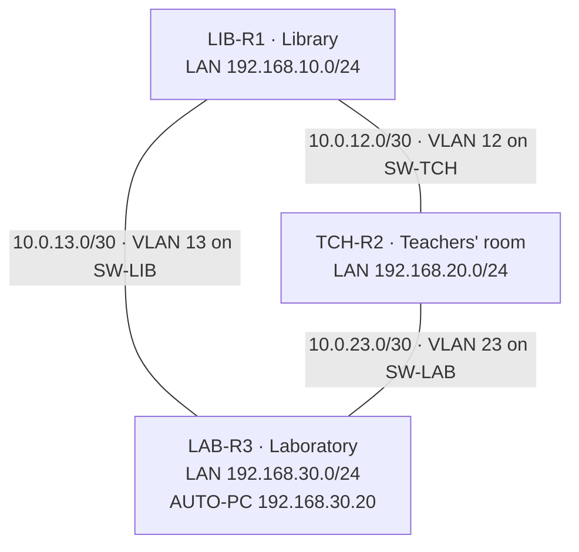

# CCEN 356 Project 1: RIP Dynamic Routing with Python Automation

A three-room school network (Library, Teachers' room, Laboratory) on Cisco 2901 routers running RIPv2, with Python scripts that log into the routers over SSH, push configuration, snapshot the routing tables, and measure how long RIP takes to converge after a link fails. Built and tested on the lab hardware on 6 Nov 2026.

## Network

Three routers in a triangle, so every room has two paths to every other room. The brief asks for "Ethernet links and Serial links (where applicable)": the lab 2901s have only two onboard ports (G0/0, G0/1) and no serial modules, so serial was not applicable and **all links are Ethernet**. Each router's G0/0 is an 802.1Q trunk to its room switch, carrying the LAN and one WAN link as VLANs; each router's G0/1 goes to the next room's switch.



| Router | LAN | Links |
|---|---|---|
| LIB-R1 | G0/0.10 192.168.10.1/24 | G0/1 to TCH-R2 G0/0.12; G0/0.13 to LAB-R3 G0/1 |
| TCH-R2 | G0/0.20 192.168.20.1/24 | G0/0.12 to LIB-R1 G0/1; G0/1 to LAB-R3 G0/0.23 |
| LAB-R3 | G0/0.30 192.168.30.1/24 | G0/0.23 to TCH-R2 G0/1; G0/1 to LIB-R1 G0/0.13 |

Each router runs `router rip`, `version 2`, `no auto-summary`, network statements for 10.0.0.0 and its LAN, with the LAN subinterface passive. Each room has a Catalyst 3560-8PC switch (PCs on Fa0/1–6, router trunk on Fa0/7, the neighbour router's WAN link on Fa0/8); the IP plan assigns PCs, laptops and a printer per room. Design, cabling and expected routing tables: [`docs/Design-Change-All-Ethernet.md`](docs/Design-Change-All-Ethernet.md), which updates the original [Part 1 design](docs/Part1-Network-Design-and-RIP-Configuration.pdf) (serial version) for the lab hardware.

## Repository layout

```
configs/source/      paste-in configs for the 3 routers and 3 switches (what was typed in)
configs/exports/     show running-config exports from all 6 built devices
configs/push/        config snippets for push_config.py (RIP blocks, timestamps, test actions)
scripts/             Python automation (below)
tests/               tests for the parsers and scripts; no routers needed
data/verification/   show command outputs, RIP push outputs, device screenshots, incident note
data/snapshots/      JSON routing-table snapshots (T0, before/after every run, T-end)
data/routes.csv      every snapshot, one row per route
data/debug_logs/     debug ip rip / debug ip routing captures and their parsed CSVs
data/monitor_logs/   1-second route monitor logs
data/ping_logs/photos/  ping and traceroute photos, before/after each run
data/console_logs/   PuTTY console session logs
data/results.csv     results table, one row per run
data/charts/         charts for the report
docs/                design docs, lab day test plan, report section drafts, evidence guide, report tasks
topology/            topology diagram (to add) and rack/cabling photos
```

## Scripts

| Script | What it does |
|---|---|
| [`inventory.py`](scripts/inventory.py) | Router list and `connect(name)` over SSH (netmiko), imported by every other script |
| [`connect_test.py`](scripts/connect_test.py) | Logs into each router and checks its hostname: proves SSH works |
| [`push_config.py`](scripts/push_config.py) | Applies config lines from a file to one or more routers, then saves (or `--no-save`) |
| [`get_routes.py`](scripts/get_routes.py) | Snapshots `show ip route rip` on every router to JSON and CSV |
| [`compare_routes.py`](scripts/compare_routes.py) | Lists routes added, removed or changed between two snapshots |
| [`capture_rip_debug.py`](scripts/capture_rip_debug.py) | Turns on `debug ip rip` + `debug ip routing`, records them from the router's log buffer, turns them off |
| [`parse_rip_debug.py`](scripts/parse_rip_debug.py) | Parses a capture (updates sent/received, link changes, route installs) and measures convergence |
| [`monitor_convergence.py`](scripts/monitor_convergence.py) | Polls a router every second and logs when a route changes; reconnects if SSH drops |
| [`run_experiment.py`](scripts/run_experiment.py) | Runs one test end to end: snapshot, precondition, debugs, monitor, operator mark, read-back, diff |
| [`experiments.py`](scripts/experiments.py) | The T0–T5 test definitions: measured router, watched route, expected result, operator steps |
| [`collect_results.py`](scripts/collect_results.py) | Builds `data/results.csv` and the Markdown results table from the saved logs |
| [`visualize.py`](scripts/visualize.py) | Draws the convergence comparison chart and the per-test route timelines |
| [`sim_router.py`](scripts/sim_router.py) | A pretend router used by the tests, so they run without hardware |

## Setup

Python 3.10 or newer, on AUTO-PC (192.168.30.20 on SW-LAB Fa0/5) or any machine that can reach the routers.

```
pip install -r requirements.txt
python -m pytest
```

The tests run without routers. `paramiko` is pinned to 3.5.1: the lab's IOS 15.0 only offers SHA-1 key exchange, which paramiko 5 removed.

The scripts log in with the lab credentials from the configs (`admin` / `Admin@123`, enable secret `class123`). These are lab-only placeholders; the lab devices were wiped after the session. Override them without editing code:

```powershell
$env:RIP_USER = "admin"; $env:RIP_PASS = "other-password"; $env:RIP_SECRET = "other-secret"
```

## Usage

Run everything from the repo root.

```
python scripts/connect_test.py                                   # SSH into all 3 routers
python scripts/push_config.py configs/push/timestamps.txt all    # ms timestamps + 64 KB debug buffer
python scripts/push_config.py configs/push/rip-LIB-R1.txt LIB-R1 # push the RIP block from Python
python scripts/capture_rip_debug.py LIB-R1 --label T0-updates --duration 40
python scripts/get_routes.py T0-baseline                         # snapshot -> data/snapshots/ + data/routes.csv
python scripts/run_experiment.py T1 --run 1 --duration 120       # one test run (see the lab day plan)
python scripts/compare_routes.py T1-run1-before T1-run1-after    # what changed
python scripts/collect_results.py                                # data/results.csv + Markdown table
python scripts/visualize.py                                      # data/charts/
```

Files in `configs/push/` hold config-mode lines only (no `configure terminal` or `end`); `push_config.py` adds those itself. The step-by-step procedure used in the lab is [`docs/Lab-Day-Test-Plan.md`](docs/Lab-Day-Test-Plan.md).

## Link-failure tests

| Test | Cause | Expected result |
|---|---|---|
| T0 Baseline | all links up | every remote LAN at metric 1 |
| T1 | shut LIB-R1 G0/1 + TCH-R2 G0/0.12 | LIB-R1 reaches 192.168.20.0/24 via LAB-R3, metric 2 |
| T2 | shut LAB-R3 G0/1 + LIB-R1 G0/0.13 | LAB-R3 reaches 192.168.10.0/24 via TCH-R2, metric 2 |
| T3 | shut TCH-R2 G0/1 + LAB-R3 G0/0.23 | TCH-R2 reaches 192.168.30.0/24 via LIB-R1, metric 2 |
| T4 | bring the T1 link back | the 1-hop route returns |
| T5 Silent failure | `passive-interface G0/1` on LAB-R3 | LIB-R1 waits for RIP's timers: about 240 to 270 s |

The WAN links run through switches, so each link test shuts both ends, the way a cut cable would. The measured router's end is always its physical G0/1, because a subinterface shutdown logs no `%LINK` line.

Convergence is measured on the measured router's own clock: from the first `RT: del` of the failed route (IOS logs `%LINK` about 2 s later) to the `RT: add` line where the new route is installed. For T5 nothing goes down, so it starts from the last update heard from LAB-R3 (`--silent-peer 10.0.13.2`), which is where RIP's invalid timer starts counting.

## Results (6 Nov 2026)

| Test | Run 1 (s) | Run 2 (s) | Run 3 (s) | Average (s) | Pings lost (avg) |
|---|---|---|---|---|---|
| T1 Library–Teachers link down | 7.10 | 5.64 | 4.65 | 8.56 (4 runs; run 4: 16.85) | 32 |
| T2 Library–Lab link down | 16.47 | 19.12 | 27.04 | 20.87 | 29 |
| T3 Teachers–Lab link down | 9.20 | 16.93 | 11.36 | 12.50 | 33 |
| T4 Recovery (T1 link back up) | 17.56 | 20.41 | 27.96 | 21.98 | 0 |
| T5 Silent failure (no updates) | 260.26 | 248.65 | 262.35 | 257.09 | 24 |

Full per-run data: [`data/results.csv`](data/results.csv). Charts: [`data/charts/`](data/charts/). Which evidence goes in the report: [`docs/Report-Evidence-Guide.md`](docs/Report-Evidence-Guide.md). T1–T4 debug captures were recovered from the console logs after the capture folder was deleted mid-session; T2's figures come from the test runner's output (details in the evidence guide).

## Team

| Member | Part |
|---|---|
| Saif | Network design and Cisco configuration |
| Mouhamed | Python automation, repository, final report |
| Zayed | Measurement, testing and visualisation |
| Abdulrahman | Introduction, convergence analysis, RIP limitations, conclusion |

Remaining report work per member: [`docs/Report-Tasks.md`](docs/Report-Tasks.md). The original [team plan](docs/Team-Plan-and-Technical-Guide-v3.pdf) was written for the serial design; the tests, commands and report tasks now follow the all-Ethernet design above.
