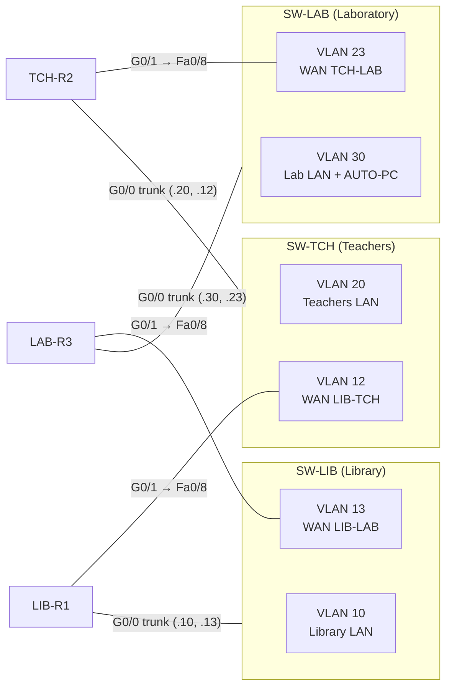

# Design change: all-Ethernet build for the lab 2901s

*5 Nov 2026; built and tested on the lab hardware on 6 Nov 2026. Replaces the topology, cabling and configs in Saif's [Part 1 design doc](Part1-Network-Design-and-RIP-Configuration.pdf). The IP plan, RIP settings, SSH settings and test goals stay the same.*

## Why the design has to change

The Part 1 design needs an **HWIC-2T serial module** in every 2901, for the two serial links. **The lab routers have no modules**, only the two onboard ports, GigabitEthernet0/0 and 0/1. This was checked on the bench on 5 Nov: `show inventory` on LIB-R1 lists only the chassis and the power supply, and the lab has no modules to lend.

A triangle needs **three** connections per router (its LAN plus two neighbours), but each router has only **two** ports. The fix is 802.1Q VLANs: one port carries two networks.

## The idea in one paragraph

Each router's **G0/0** is a trunk to its own room switch and carries two VLANs: its **LAN**, and **one WAN link**. Each router's **G0/1** is a plain port, cabled to the **next** room's switch, where it joins that WAN link's VLAN. The three switches are not connected to each other. Each WAN link lives on exactly one switch, so there are still three separate router-to-router links, and every room still has two paths to every other room.



Logically it is the same triangle as before:

| Link | Subnet | One end (physical port) | Other end (subinterface) | Runs through |
|---|---|---|---|---|
| Library–Teachers | 10.0.12.0/30 | LIB-R1 **G0/1** 10.0.12.1 | TCH-R2 **G0/0.12** 10.0.12.2 | SW-TCH, VLAN 12 |
| Library–Lab | 10.0.13.0/30 | LAB-R3 **G0/1** 10.0.13.2 | LIB-R1 **G0/0.13** 10.0.13.1 | SW-LIB, VLAN 13 |
| Teachers–Lab | 10.0.23.0/30 | TCH-R2 **G0/1** 10.0.23.1 | LAB-R3 **G0/0.23** 10.0.23.2 | SW-LAB, VLAN 23 |

## What stays the same

- **Every IP address.** LANs 192.168.10/20/30.0/24, WAN /30s 10.0.12/13/23.0, gateways .1, switches .2, AUTO-PC 192.168.30.20.
- **RIP:** `version 2`, `no auto-summary`, `network 10.0.0.0` plus the LAN, and the LAN passive. Only the passive interface's name changes, to `GigabitEthernet0/0.10`, `.20` or `.30`.
- **SSH addresses and credentials,** so `inventory.py` is unchanged.
- **DHCP pools.**
- **Every next hop and metric in the tests,** because the addresses didn't move.
- **T5:** it is still `passive-interface GigabitEthernet0/1` on LAB-R3, still silent toward LIB-R1, and `t5-start.txt` / `t5-stop.txt` are unchanged.

## Router interfaces

| Router | Interface | VLAN | IP | Connects to |
|---|---|---|---|---|
| LIB-R1 | G0/0 | trunk | none | SW-LIB Fa0/7 |
| | G0/0.10 | 10 | 192.168.10.1/24 | Library LAN |
| | G0/0.13 | 13 | 10.0.13.1/30 | LAB-R3 G0/1 (via SW-LIB) |
| | G0/1 | none | 10.0.12.1/30 | SW-TCH Fa0/8 → TCH-R2 G0/0.12 |
| TCH-R2 | G0/0 | trunk | none | SW-TCH Fa0/7 |
| | G0/0.20 | 20 | 192.168.20.1/24 | Teachers' LAN |
| | G0/0.12 | 12 | 10.0.12.2/30 | LIB-R1 G0/1 (via SW-TCH) |
| | G0/1 | none | 10.0.23.1/30 | SW-LAB Fa0/8 → LAB-R3 G0/0.23 |
| LAB-R3 | G0/0 | trunk | none | SW-LAB Fa0/7 |
| | G0/0.30 | 30 | 192.168.30.1/24 | Lab LAN |
| | G0/0.23 | 23 | 10.0.23.2/30 | TCH-R2 G0/1 (via SW-LAB) |
| | G0/1 | none | 10.0.13.2/30 | SW-LIB Fa0/8 → LIB-R1 G0/0.13 |

## Switch ports

The lab switches are Catalyst 3560-8PCs (FastEthernet0/1 to 0/8, plus one GigabitEthernet0/1 uplink we leave unused). A 3560 only accepts `switchport mode trunk` after `switchport trunk encapsulation dot1q`, so the configs set it first. Their software (C3560-IPBASE) has no crypto, so the switches take Telnet for remote login instead of SSH; the Python scripts only SSH to the routers. The last two ports on every switch face the routers: **Fa0/7** is the trunk to the room's own router and **Fa0/8** is the WAN link from the neighbour. The router links therefore run at 100 Mbps, which is plenty for RIP and the tests.

| Switch | Fa0/7 (trunk to own router G0/0) | Fa0/8 (access, neighbour's G0/1) | End devices (access) | Mgmt IP |
|---|---|---|---|---|
| SW-LIB | VLANs 10, 13 → LIB-R1 | VLAN 13 ← LAB-R3 G0/1 | Fa0/1–6, VLAN 10 | Vlan10 192.168.10.2 |
| SW-TCH | VLANs 20, 12 → TCH-R2 | VLAN 12 ← LIB-R1 G0/1 | Fa0/1–6, VLAN 20 | Vlan20 192.168.20.2 |
| SW-LAB | VLANs 30, 23 → LAB-R3 | VLAN 23 ← TCH-R2 G0/1 | Fa0/1–6, VLAN 30 (Fa0/5 = AUTO-PC) | Vlan30 192.168.30.2 |

Every port facing a router has `spanning-tree portfast` (`portfast trunk` on the trunks). Without it, a port that comes back up waits 30 s in spanning-tree before forwarding, and T4 would measure spanning-tree instead of RIP.

## Cabling (9 router/switch cables, all straight-through)

| # | From | To |
|---|---|---|
| 1 | LIB-R1 G0/0 | SW-LIB Fa0/7 |
| 2 | TCH-R2 G0/0 | SW-TCH Fa0/7 |
| 3 | LAB-R3 G0/0 | SW-LAB Fa0/7 |
| 4 | LIB-R1 G0/1 | **SW-TCH** Fa0/8 |
| 5 | TCH-R2 G0/1 | **SW-LAB** Fa0/8 |
| 6 | LAB-R3 G0/1 | **SW-LIB** Fa0/8 |
| 7 | Library PC | SW-LIB Fa0/1 |
| 8 | Teachers' PC | SW-TCH Fa0/1 |
| 9 | AUTO-PC | SW-LAB Fa0/5 |

Remember it as: **each router's G0/1 goes to the next room's switch** (Library → Teachers → Lab → Library), always into Fa0/8.

## Expected `show ip route rip` with all links up

```
LIB-R1
R    10.0.23.0/30 [120/1] via 10.0.12.2, GigabitEthernet0/1
                  [120/1] via 10.0.13.2, GigabitEthernet0/0.13
R    192.168.20.0/24 [120/1] via 10.0.12.2, GigabitEthernet0/1
R    192.168.30.0/24 [120/1] via 10.0.13.2, GigabitEthernet0/0.13

TCH-R2
R    10.0.13.0/30 [120/1] via 10.0.12.1, GigabitEthernet0/0.12
                  [120/1] via 10.0.23.2, GigabitEthernet0/1
R    192.168.10.0/24 [120/1] via 10.0.12.1, GigabitEthernet0/0.12
R    192.168.30.0/24 [120/1] via 10.0.23.2, GigabitEthernet0/1

LAB-R3
R    10.0.12.0/30 [120/1] via 10.0.13.1, GigabitEthernet0/1
                  [120/1] via 10.0.23.1, GigabitEthernet0/0.23
R    192.168.10.0/24 [120/1] via 10.0.13.1, GigabitEthernet0/1
R    192.168.20.0/24 [120/1] via 10.0.23.1, GigabitEthernet0/0.23
```

## What changes in the tests, and why

**1. Both ends of the link are shut.** Each WAN link now runs through a switch. When one router's port goes down, the switch port goes down, but the router at the other end still sees its own port up. It only gives up on the link when RIP's 180 s invalid timer expires, so every test would partly turn into T5. To make a failure behave like a cut cable, the tests shut **both ends**:
- the measured router's end on "go": on its console, or pushed from the laptop when the laptop's SSH path does not cross the link (T2);
- the far end a few seconds later, with `push_config.py` (or a console where SSH would go over the link being cut).

**2. The measured end is always a physical port.** We tested this on LIB-R1 on 5 Nov: shutting a **subinterface** logs **no** `%LINK` / `%LINEPROTO` line, only `%SYS-5-CONFIG_I` when you type `end`. `parse_rip_debug.py` finds the failure by its `%LINK` line (and starts the clock at the `RT: del` just before it, because IOS logs `%LINK` about 2 s after deleting the routes), so the measured router must be the one whose end is a physical G0/1 port. Because of this, **T2 is now measured on LAB-R3**, the physical end of the Library–Lab link, instead of LIB-R1.

| Test | Measured router | Measured end (on "go") | Far end (just after) | Route watched → expected |
|---|---|---|---|---|
| T1 | LIB-R1 | LIB-R1 console: G0/1 `shutdown` | TCH-R2 G0/0.12, `push_config.py configs/push/t1-far-down.txt TCH-R2 --no-save` | 192.168.20.0/24 → via 10.0.13.2, metric 2 |
| T2 | **LAB-R3** | LAB-R3 G0/1, `push_config.py configs/push/t2-measured-down.txt LAB-R3 --no-save` (LAB-R3 is on the laptop's LAN) | LIB-R1 G0/0.13 `shutdown` **on the LIB-R1 console** (SSH to LIB-R1 uses this link) | **192.168.10.0/24 → via 10.0.23.1, metric 2** |
| T3 | TCH-R2 | TCH-R2 console: G0/1 `shutdown` | LAB-R3 G0/0.23, `push_config.py configs/push/t3-far-down.txt LAB-R3 --no-save` | 192.168.30.0/24 → via 10.0.12.1, metric 2 |
| T4 | LIB-R1 | LIB-R1 console: G0/1 `no shutdown` | **First, before "go":** `push_config.py configs/push/t1-far-up.txt TCH-R2 --no-save` | 192.168.20.0/24 → via 10.0.12.2, metric 1 |
| T5 | LIB-R1 | (no shutdown) `t5-start.txt` on LAB-R3 | none | 192.168.30.0/24 → via 10.0.12.2, metric 2 (unchanged) |

Side effects:
- **T2's measured SSH session no longer drops,** because AUTO-PC is on LAB-R3's LAN.
- **T3's session to TCH-R2 still drops.** The monitor reconnects, as before.
- **T3's ping should run from the Teachers' PC to 192.168.30.1.** Traffic from the Library to the Lab doesn't use the Teachers–Lab link.

## What this changes in the report

| Section | Change |
|---|---|
| 2 Network design | New topology diagram and cabling table (above). Explain why: no HWIC-2T in the lab, so VLANs give each router a third connection |
| 3 RIP configuration | Subinterfaces with `encapsulation dot1Q`, passive interface `G0/0.x`, switch VLANs, trunks, portfast. The RIP block itself is unchanged |
| 4 Verification | The expected tables above. Add `show vlan brief` and `show interfaces trunk` on each switch |
| 6a Tests | T2 measured on LAB-R3. Failures are cut at both ends; say why (a failure through a switch is only seen at one end) |
| 6b Analysis | The "one end only" effect is worth a sentence: on a switched link, a dead neighbour is only noticed via RIP's timers, which is the T5 situation. It's a real-world argument for BFD or a faster protocol |
| 7 Limitations | The "Ethernet vs 64 kbps serial both count as 1 hop" example no longer applies to our build. Make the point in general terms: RIP ignores bandwidth |

The Packet Tracer file (`topology/school-rip.pkt`) should be rebuilt the same way, with 2901s without the HWIC-2T and the same VLANs. The `data/simulated/` files and `SIMULATED_*` charts still use the old serial interface names; they only ever tested the scripts and are not used in the report.

## Files changed for this design

- `configs/source/*.txt`: all 6 paste-in configs
- `configs/push/rip-*.txt`: passive interface `G0/0.x`
- `configs/push/t1-far-down.txt`, `t1-far-up.txt`, `t3-far-down.txt`, `t3-far-up.txt`: new; they shut and restore the far end
- `configs/push/t2-measured-down.txt`, `t2-measured-up.txt`: new; they shut and restore LAB-R3 G0/1 (T2 measured end)
- `configs/source/SW-*.txt`: 3560-8PC ports (Fa0/7 trunk, Fa0/8 WAN), `switchport trunk encapsulation dot1q`, Telnet instead of SSH
- `scripts/experiments.py`: T1 to T4 operator steps; T2 now measured on LAB-R3
- `scripts/visualize.py`: chart labels say "link down" instead of "serial down"
- `tests/test_visualize_and_results.py`: T2's new definition
- `docs/Lab-Day-Test-Plan.md`: the build, the checks and the test steps
